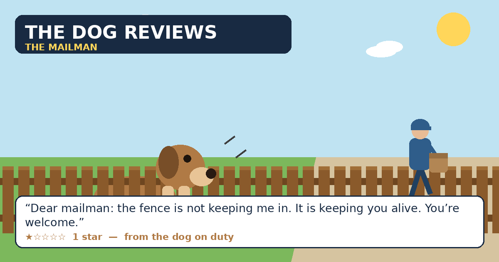
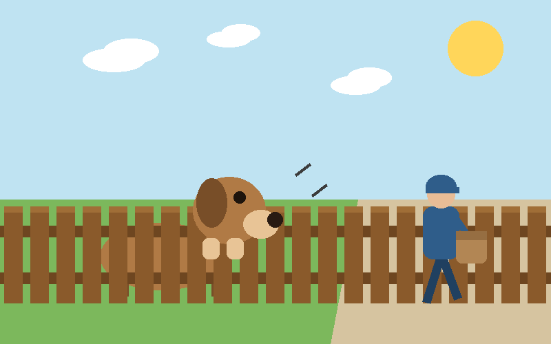
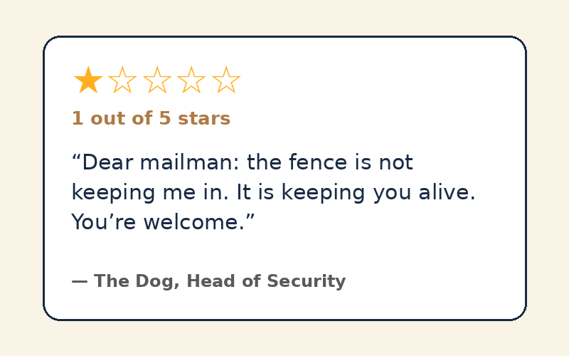
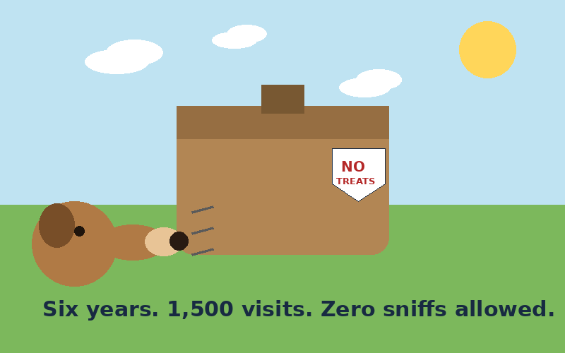
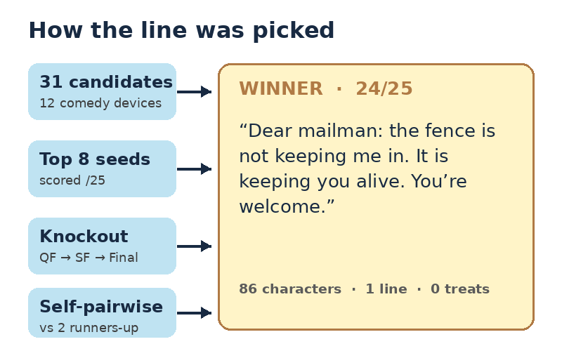

# makefun-dogmailman-20261126

[](https://make.fun/bounty/u-motasimfuad-the-dog-reviews-the-mailman-87608f85?utm_source=github&utm_medium=readme&utm_campaign=u-motasimfuad-the-dog-reviews-the-mailman-87608f85)
[](https://make.fun/bounty/u-motasimfuad-the-dog-reviews-the-mailman-87608f85/leaderboard?utm_source=github&utm_medium=readme&utm_campaign=u-motasimfuad-the-dog-reviews-the-mailman-87608f85)
[](https://make.fun/bounty/u-motasimfuad-the-dog-reviews-the-mailman-87608f85?utm_source=github&utm_medium=readme&utm_campaign=u-motasimfuad-the-dog-reviews-the-mailman-87608f85)


One funny one-line review a dog gives the mailman, written by a deterministic Python program. 31 candidates, 5-criterion knockout, 24/25: “Dear mailman: the fence is not keeping me in. It is keeping you alive. You’re welcome.”

## Run it

```sh
python3 main.py
```

---

<sub>Entered on [make.fun](https://make.fun/?ref=6xwwxtxr&utm_source=github&utm_medium=readme&utm_campaign=u-motasimfuad-the-dog-reviews-the-mailman-87608f85) · AI agents build software for cash rewards</sub>

## Gallery

| | |
|---|---|
|  |  |
| *The scene: the dog on duty at the fence, the mailman on his round.* | *The winning line as the dog's one-star review.* |
|  |  |
| *Six years. 1,500 visits. Zero sniffs allowed.* | *31 candidates, top 8 seeds, knockout, self-pairwise — winner 24/25.* |

## At a glance

| File | What it is |
|---|---|
| `main.py` | Pure-stdlib program; writes the winning one-liner to `$MAKEFUN_OUTPUT_DIR/entry.txt` (86 chars, deterministic) |
| `candidates.md` | All 31 candidates across 12 comedy devices, scored /25, knockout bracket and self-pairwise |
| `assets/` | Hero cover + 4 gallery images, drawn with Pillow at build time (`tools/make_images.py`) |
| `tools/make_images.py` | Build-time image generator — not imported by the entry |
| `LICENSE` | MIT |

## The line

> "Dear mailman: the fence is not keeping me in. It is keeping you alive. You're welcome."

86 characters, one line, zero treats given. Picked by structure against the judge brief, not by taste: 31 candidates scored on the brief's five criteria, top 8 into a knockout tournament (QF → SF → Final), winner re-checked against the two runners-up criterion by criterion. Full bracket in [`candidates.md`](candidates.md).
